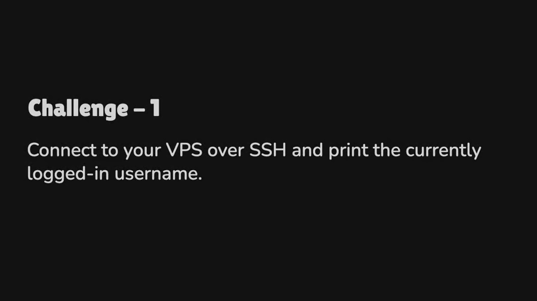
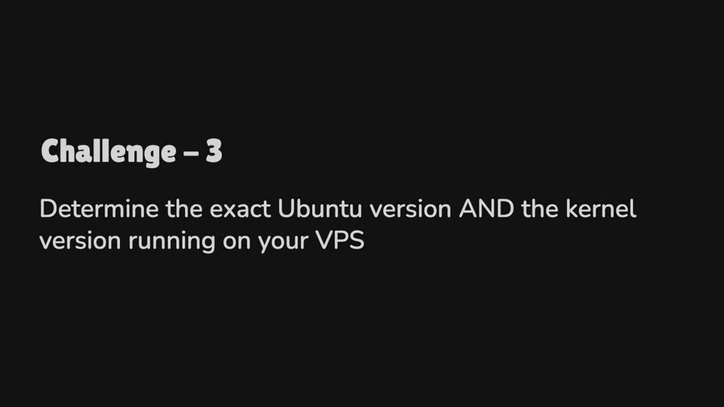

## 💪 Hands-On Exercises

### Exercise 1: Getting Started

### Challenge - 1

 


### Challenge - 2


### Challenge - 3



### Challenge - 4


### Exercise 2: Permissions Practice


### Exercise 3: Search and Filter


# Find all ERROR lines
grep ERROR sample.log

# Count ERROR lines
grep -c ERROR sample.log

# Find ERROR or WARN
grep -E "ERROR|WARN" sample.log
```

### Exercise 4: Simple Backup Script

Create `backup.sh`:

```bash
#!/bin/bash

# Configuration
SOURCE="$HOME/devops-workshop"
DEST="$HOME/backups"
DATE=$(date +%Y%m%d_%H%M%S)

# Create backup directory if it doesn't exist
mkdir -p $DEST

# Create backup
tar -czf $DEST/backup_$DATE.tar.gz $SOURCE

# Verify
if [ $? -eq 0 ]; then
    echo "✅ Backup created: backup_$DATE.tar.gz"
    ls -lh $DEST/backup_$DATE.tar.gz
else
    echo "❌ Backup failed"
    exit 1
fi
```

Run:
```bash
chmod +x backup.sh
./backup.sh
```

---

## 🎯 Summary

### Key Commands Learned

| **Category** | **Commands** |
|--------------|--------------|
| Navigation | `pwd`, `ls`, `cd`, `tree` |
| Files | `touch`, `cat`, `cp`, `mv`, `rm` |
| Permissions | `chmod`, `chown` |
| Search | `grep`, `find` |
| Network | `curl`, `ping`, `netstat` |
| Process | `ps`, `top`, `kill` |
| Scripting | Variables, loops, conditionals |

### Best Practices

1. ✅ Always use **tab completion** to avoid typos
2. ✅ Use `man command` to read manual pages
3. ✅ Test destructive commands (`rm -rf`) in safe environments
4. ✅ Use version control (Git) for scripts
5. ✅ Add comments to your scripts

---

## 📖 Further Resources

- [Linux Journey](https://linuxjourney.com/)
- [Bash Scripting Tutorial](https://linuxconfig.org/bash-scripting-tutorial)
- [ExplainShell](https://explainshell.com/) - Explains shell commands
- [Bash Guide for Beginners](https://tldp.org/LDP/Bash-Beginners-Guide/html/)

---

**Next**: [Git Hands-On →](./03-git-hands-on.md)
