## 💪 Hands-On Exercises

### Exercise 1: Getting Started

### Challenge - 1


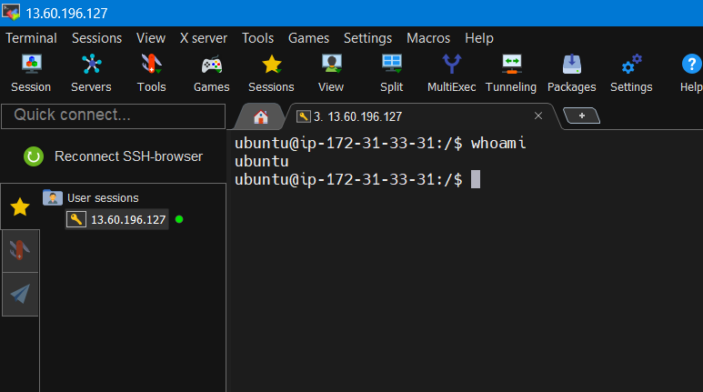

### Challenge - 2

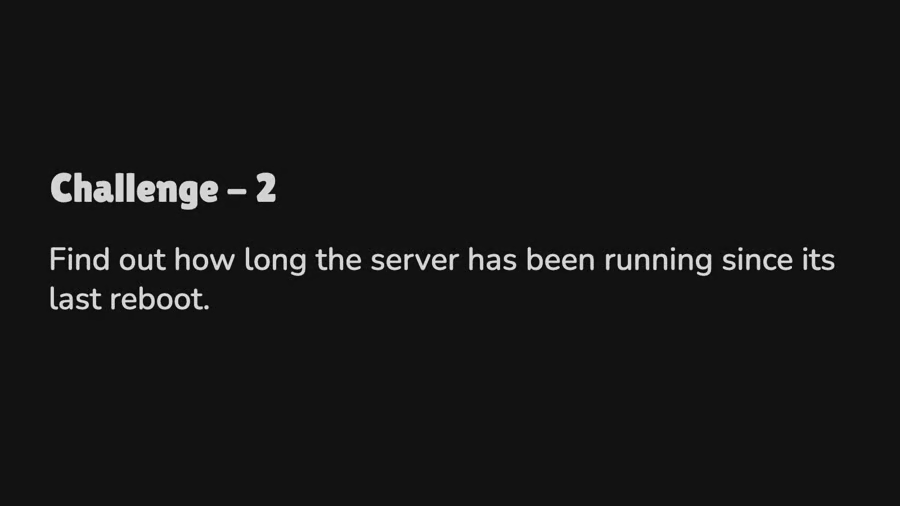

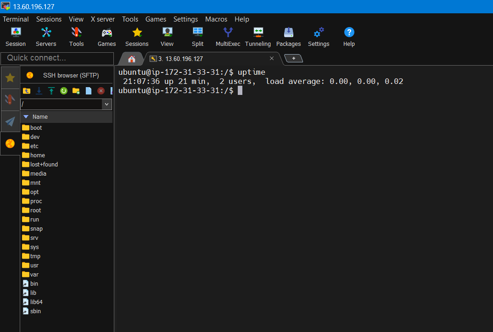

### Challenge - 3


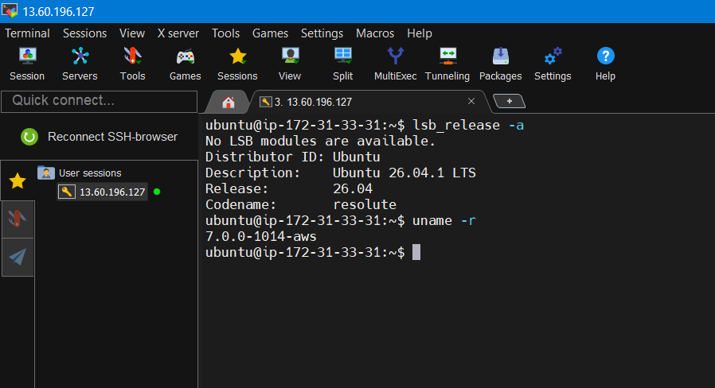

### Challenge - 4

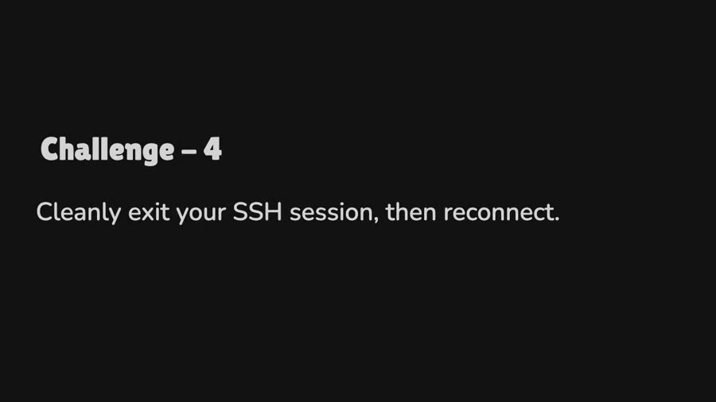

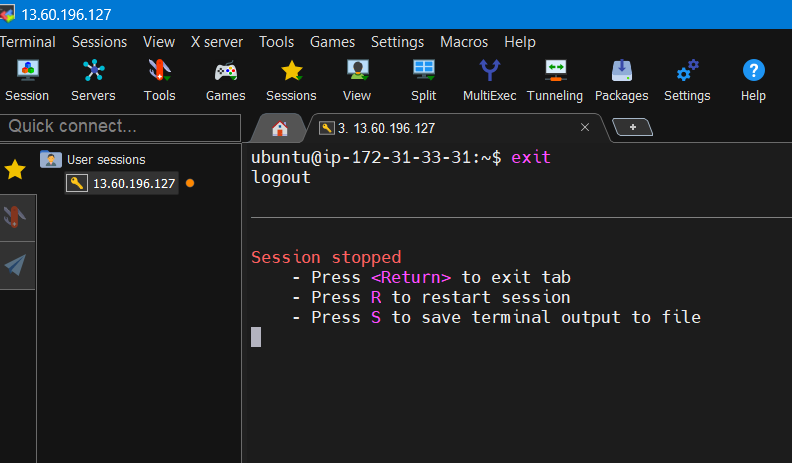

### Linux is C000000000000l


## Exercise 2: File System & Navigation

### Challenge - 1

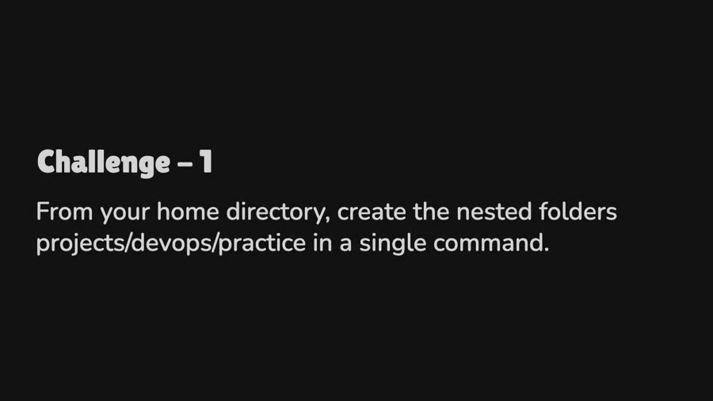

### Solution

```bash
ubuntu@ip-172-31-33-31:/home$ mkdir -p projects/devops/practice
```

**Explanation:**

- `mkdir` – creates directories.
- `-p` – creates parent directories if they don't exist.
- `projects/devops/practice` – nested directory path.

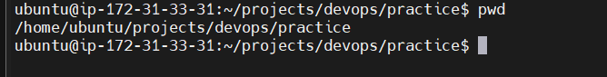


### Challenge - 2

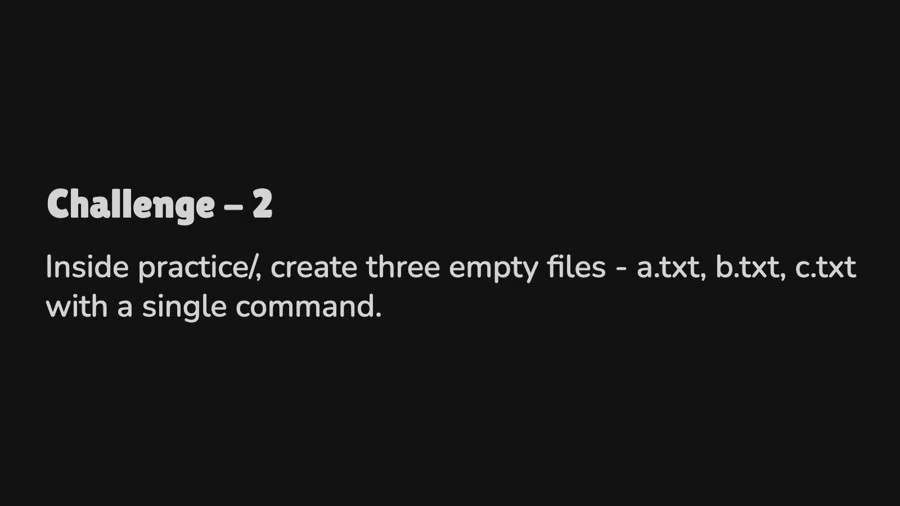

### Solution

```bash
touch file1.txt file2.txt file3.txt

ubuntu@ip-172-31-33-31:~/projects/devops/practice$ touch a.txt b.txt c.txt

ubuntu@ip-172-31-33-31:~/projects/devops/practice$ ls
a.txt  b.txt  c.txt
```

### Challenge - 3

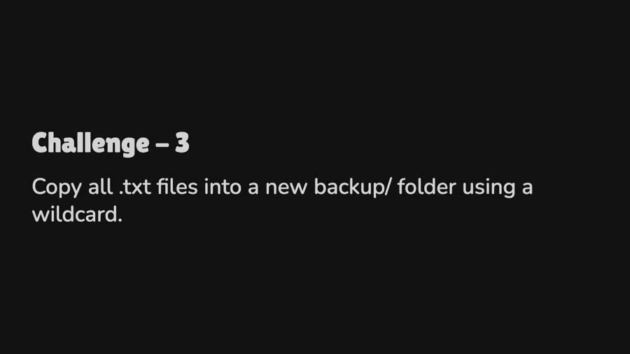

### Solution

```bash
cp *.txt wildcard/
```

| Command | Purpose |
|---|---|
| `cp` | Copies files; originals remain |
| `mv` | Moves files; originals disappear from the source |
| `*.txt` | Matches all `.txt` files |

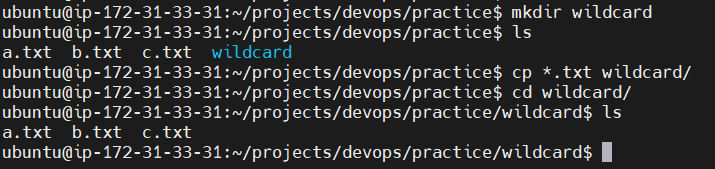


### Challenge - 4


### Solution

**Copy**

```bash
cp source.txt destination.txt
cp -r sourcedir/ destdir/
```

**Move / Rename**

```bash
mv oldname.txt newname.txt
mv file.txt /path/to/destination/
```

**Delete**

```bash
rm filename.txt
rm -r directory/
rm -rf directory/
rm -i file.txt
```

**Practical execution:**

```bash
ubuntu@ip-172-31-33-31:~/projects/devops/practice/wildcard$ ls
a.txt  b.txt  c.txt

ubuntu@ip-172-31-33-31:~/projects/devops/practice/wildcard$ cd ..

ubuntu@ip-172-31-33-31:~/projects/devops/practice$ mv b.txt notes.txt

ubuntu@ip-172-31-33-31:~/projects/devops/practice$ ls
a.txt  c.txt  notes.txt  wildcard
```


### Challenge - 5

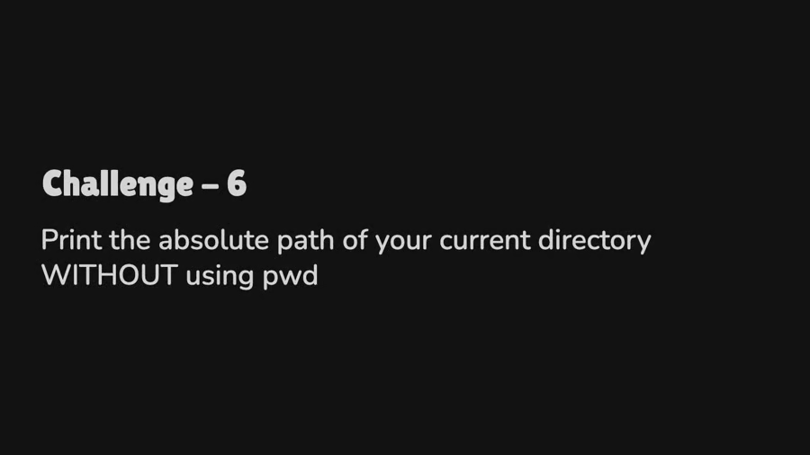

### Solution

```bash
ubuntu@ip-172-31-33-31:~/projects/devops/practice$ echo $PWD

/home/ubuntu/projects/devops/practice
```

The `$PWD` environment variable displays the current working directory.


### Challenge - 6

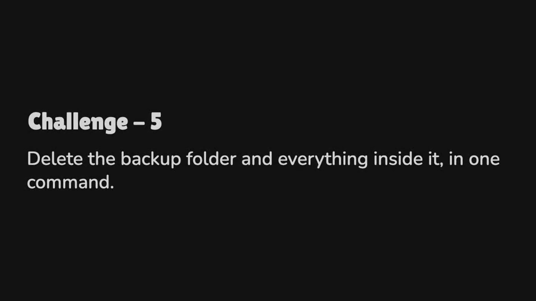

### Solution

```bash
ubuntu@ip-172-31-33-31:~/projects/devops/practice$ ls
a.txt  c.txt  notes.txt  wildcard

ubuntu@ip-172-31-33-31:~/projects/devops/practice$ rm -r wildcard

ubuntu@ip-172-31-33-31:~/projects/devops/practice$ ls
a.txt  c.txt  notes.txt
```


## 🎯 Summary

### Key Commands Learned

| Category | Commands |
|---|---|
| Navigation | `pwd`, `ls`, `cd`, `tree` |
| Files | `touch`, `cat`, `cp`, `mv`, `rm` |
| Permissions | `chmod`, `chown` |
| Search | `grep`, `find` |
| Network | `curl`, `ping`, `netstat` |
| Process | `ps`, `top`, `kill` |
| Scripting | Variables, loops, conditionals |


### Best Practices

1. ✅ Always use **tab completion** to avoid typos.
2. ✅ Use `man command` to read manual pages.
3. ✅ Test destructive commands (`rm -rf`) in safe environments.
4. ✅ Use version control (Git) for scripts.
5. ✅ Add comments to your scripts.


---

## 📖 Further Resources

- [Linux Journey](https://linuxjourney.com/)
- [Bash Scripting Tutorial](https://linuxconfig.org/bash-scripting-tutorial)
- [ExplainShell](https://explainshell.com/) - Explains shell commands.
- [Bash Guide for Beginners](https://tldp.org/LDP/Bash-Beginners-Guide/html/)


---

**Next:** [Git Hands-On →](./03-git-hands-on.md)
